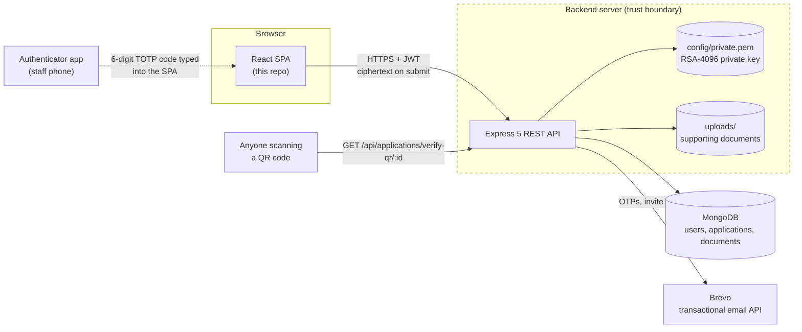
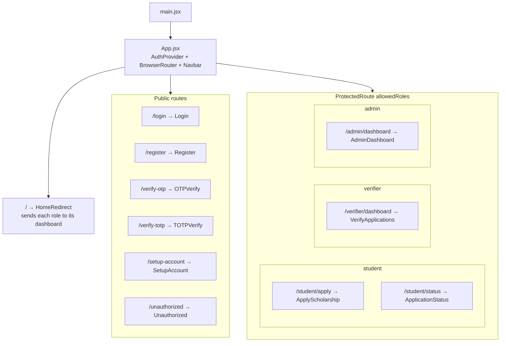
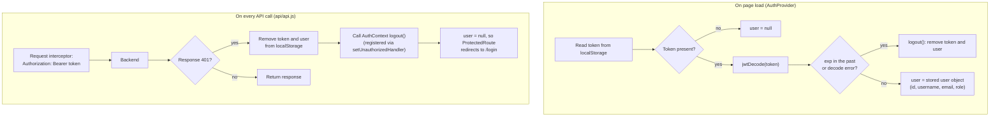
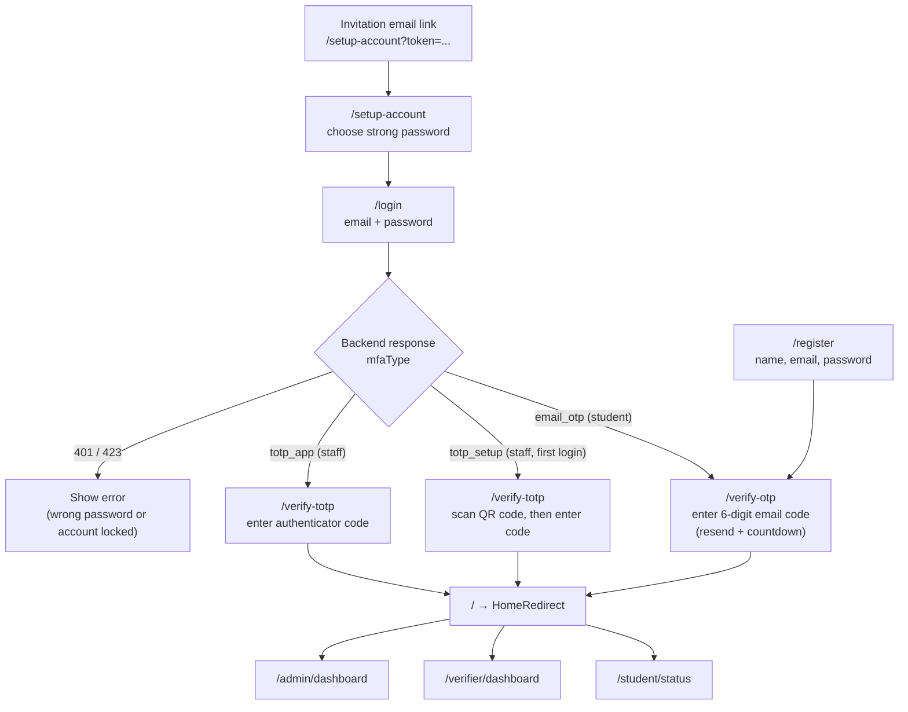
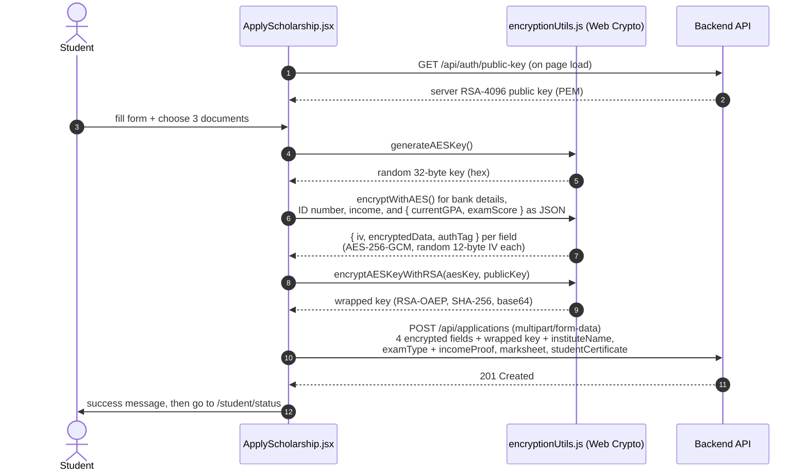
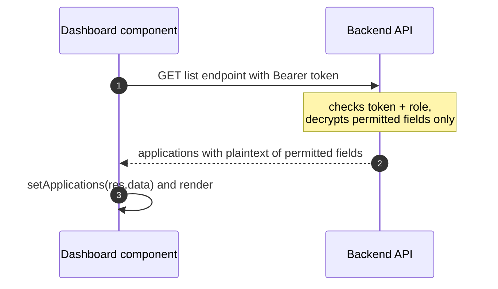

# SafeApply Frontend Architecture

This document explains how the SafeApply React client is put together, for anyone setting it up, using it, or contributing to it. It covers the app structure, session handling, the authentication screens, and how the browser encrypts application data before sending it.

SafeApply is a scholarship application system with three roles: **Student** (applies and tracks status), **Verifier** (reviews and verifies applications) and **Admin** (approves or rejects applications and manages staff).

The server side (API, authentication rules, decryption, signatures, data model) has its own document: [Backend Architecture](https://github.com/USER1043/ScholarshipSystem-Backend/blob/main/docs/ARCHITECTURE.md).

## Contents

1. [System context](#1-system-context)
2. [App structure](#2-app-structure)
3. [Session handling](#3-session-handling)
4. [Screen flows: login, registration and staff setup](#4-screen-flows-login-registration-and-staff-setup)
5. [Submitting an application: browser-side encryption](#5-submitting-an-application-browser-side-encryption)
6. [Dashboards: reading data](#6-dashboards-reading-data)
7. [Design decisions and trade-offs](#7-design-decisions-and-trade-offs)
8. [Known limitations and quirks](#8-known-limitations-and-quirks)
9. [Contributing](#9-contributing)

---

## 1. System context

Everything inside the dashed box runs on the backend server. The browser only ever sends sensitive fields to the server as ciphertext.

## 2. App structure

`main.jsx` renders `App.jsx`, which wraps every route in `AuthProvider` so any component can read the logged-in user.

`ProtectedRoute` sends users who aren't logged in to `/login`, and users with the wrong role to `/unauthorized`. `HomeRedirect` sends students to `/student/status`, verifiers to `/verifier/dashboard` and admins to `/admin/dashboard`.

### Where code lives

| Folder / file | Responsibility |
| --- | --- |
| `src/api/api.js` | Axios instance: base URL from `VITE_BASE_URL`, attaches the JWT, clears the session on 401 |
| `src/context/AuthContext.jsx` | Login, OTP/TOTP verification, registration, logout; stores the session |
| `src/utils/encryptionUtils.js` | AES key generation, AES-GCM encryption, RSA wrapping of the AES key (Web Crypto API) |
| `src/utils/roleHelper.js` | Role constants used by routes and redirects |
| `src/components/Auth/` | Login, Register, OTPVerify, TOTPVerify, SetupAccount |
| `src/components/Student/` | ApplyScholarship (encrypts and submits), ApplicationStatus |
| `src/components/Verifier/` | VerifyApplications |
| `src/components/Admin/` | AdminDashboard (approvals, rejections, staff onboarding, user management) |
| `src/components/Common/` | Navbar, ProtectedRoute, HomeRedirect, Unauthorized |

## 3. Session handling

- After a successful OTP or TOTP check, `AuthContext` stores `token`, `user` and (if "trust this device" was ticked) `deviceId` in `localStorage`.
- `jwtDecode` only reads the token's expiry. It does **not** verify the signature, and it doesn't need to: the backend verifies every token on every protected request.
- Route guards only decide which screens to show. **Access control is enforced by the backend**, which checks the token and role on every request.

## 4. Screen flows: login, registration and staff setup

- Students always use an email OTP, and the first successful OTP also activates a newly registered account.
- Staff always use an authenticator app. On the first login the backend returns a QR code, which `TOTPVerify` displays for scanning.
- Staff accounts can't be self-registered; an admin creates them from `AdminDashboard`, which sends the invitation email.

## 5. Submitting an application: browser-side encryption

`ApplyScholarship.jsx` encrypts the sensitive fields with helpers from `utils/encryptionUtils.js` before anything is sent. The plaintext values and the AES key never leave the browser unencrypted.

| Sent encrypted | Sent in plaintext |
| --- | --- |
| Bank details, Aadhaar ID number, income details, GPA and exam score | Institute name, exam type (JEE / NEET / GATE), uploaded documents; the applicant's name comes from their account |

The documents are protected in transit by HTTPS and by server-side access checks, but they are **not** encrypted by the browser.

## 6. Dashboards: reading data

The browser never decrypts application data, and there is no decryption helper in the codebase. The backend decrypts on the server and returns only the fields each role is allowed to see (see [Backend Architecture, section 7](https://github.com/USER1043/ScholarshipSystem-Backend/blob/main/docs/ARCHITECTURE.md#7-reviewing-server-side-least-privilege-decryption)).

| Component | Endpoint | Sensitive fields it receives |
| --- | --- | --- |
| `ApplicationStatus` (student) | `GET /api/applications/my` | bank details, ID number, income, GPA, exam score (own applications only) |
| `VerifyApplications` | `GET /api/verifier/applications` | ID number, income, GPA, exam score |
| `AdminDashboard` | `GET /api/admin/applications` | income, GPA, exam score |

`ApplicationStatus` also shows the QR code for approved applications and a button that calls `GET /api/applications/verify-signature/:id` to check that the approved record hasn't been tampered with.

## 7. Design decisions and trade-offs

| Decision | Alternative | Why this way | Cost |
| --- | --- | --- | --- |
| **React Context for auth** | Redux or another store | Auth is the only global state; Context is built in and enough | Every consumer re-renders when `user` changes; fine at this size |
| **One Axios instance with interceptors** | `fetch` calls in each component | Token attachment and 401 handling are written once | Components must remember to use it |
| **A registered "unauthorized handler"** | Import `AuthContext` into `api.js` | Avoids a circular import (`AuthContext` imports `api`). The context registers its `logout` at mount | A module-level variable in `api.js` |
| **JWT in `localStorage`** | `httpOnly` cookie | Simple, works with a separately hosted API, easy to attach as a Bearer header | Readable by any script on the page, so an XSS bug exposes the session. An `httpOnly` cookie fixes that but then needs CSRF protection |
| **`jwt-decode` only for expiry, not verification** | Verify in the browser | The browser has no secret to verify with, and does not need one: the server verifies every request | The UI can believe a token is valid that the server has already rejected, hence the 401 handler |
| **Encrypt with the Web Crypto API** | A JavaScript library such as `node-forge` | Built into the browser and maintained by browser vendors, so there is no dependency to patch; supports AES-GCM and RSA-OAEP with SHA-256, matching the server | Only available on secure origins (HTTPS or `localhost`); the helpers are async |
| **AES-256-GCM** | AES-256-CBC | Authenticated: tampered ciphertext, IV or tag fails to decrypt instead of returning altered data | Each field carries a 16-byte auth tag, and the backend rejects fields without one |
| **Fresh AES key and IV per submit** | One key per user | A leaked key exposes one application, not all | The wrapped key is stored with every application |
| **Nothing is decrypted in the browser** | Send wrapped keys to reviewers | The AES key never reaches any client; each role gets only its fields | The server holds the private key, so this is **not** end-to-end encryption |
| **Route groups with `ProtectedRoute allowedRoles`** | Check the role inside every page | Role gating in one place, in `App.jsx` | UX only; never a security boundary |
| **Large components with inline styles** | Split components and CSS modules | Fast to build | `AdminDashboard.jsx` is about 680 lines; harder to review and test |

## 8. Known limitations and quirks

### Limitations

- **The JWT is stored in `localStorage`.** Any script running on the page can read it, so a cross-site scripting (XSS) bug would expose the session. React escapes rendered values by default, which reduces this risk.
- **The server public key is fetched without authentication.** The site must be served over HTTPS; otherwise an attacker on the network could replace the key and read the data it wraps.
- **This is not end-to-end encryption.** The server holds the RSA private key and decrypts so that staff can review applications. The goal is that the database, backups and request logs never contain plaintext; a fully compromised server can still read everything.
- **The "trust this device" option has no effect yet.** The checkbox sends `trustDevice`, the client stores the returned `deviceId` and sends it on the next login, but the backend doesn't use it to skip MFA.

### Quirks in the current code

These will otherwise cost you time. Several make good first contributions.

1. **`App.jsx` has stray text inside `<Routes>`**: a bare `// ... inside App component return ...` line and a duplicate "Protected Routes - Admin" comment. React Router ignores non-element children, so it is harmless noise.
2. **`login()` in `AuthContext.jsx` handles a `token` in the login response.** The backend never returns one from `/auth/login` (MFA is always required), so that branch never runs.
3. **The user object comes from `localStorage`.** `AuthProvider` decodes the token only to check expiry and then uses the stored `user` (including `role`) for the UI. Changing it changes which screens appear, nothing more.
4. **The 401 handler logs out on any 401**, including a wrong password at login (harmless there, since nobody is logged in).
5. **Error responses have two shapes.** Validation failures return `{ errors: [{ msg }] }`; everything else returns `{ message }`. `ApplyScholarship.jsx` handles both; copy that pattern.
6. **`hasRole` in `utils/roleHelper.js` is not used anywhere.** Only `ROLES` is.
7. **Object URLs are never revoked.** `handleViewDocument` calls `createObjectURL` but never `revokeObjectURL`, so each opened document keeps its memory until the tab closes.
8. **Encryption errors show "Unable to connect to server."** `handleSubmit` treats any error without a server response that way; the real cause is logged to the console.

## 9. Contributing

### Trying every role locally

With the [backend](https://github.com/USER1043/ScholarshipSystem-Backend) running and the dev server on port 5173 (about 10 minutes):

1. Log in as the super admin (the backend's `SUPER_ADMIN_EMAIL` and password) and enter the code from the authenticator app.
2. Admin dashboard → onboard a verifier. Open the emailed link (`/setup-account?token=...`), choose a password, log in, and **scan the QR code on first login** (it is shown only once).
3. In a private window, register a student at `/register` and enter the OTP from the email.
4. Submit an application at `/student/apply` with three small PDFs or images.
5. Verifier: mark it verified. Admin: approve it. Student: refresh the status page and run the integrity check.

### Adding a page for an existing role

1. Create the component under `src/components/<Role>/`.
2. Add a `<Route>` inside that role's `ProtectedRoute` group in `App.jsx`.
3. Make API calls through `src/api/api.js` (never plain `fetch`/`axios`) so the token is attached automatically.
4. Make sure the backend route it calls uses `protect` and `authorize(...)`. The frontend guard alone does not secure anything.

### Adding a new sensitive field

Encrypt it in `ApplyScholarship.jsx` with the same per-application AES key (`encryptWithAES`) and send it as a JSON string. The backend changes (model, decryption field lists, signature record) are listed in [Backend Architecture, section 13](https://github.com/USER1043/ScholarshipSystem-Backend/blob/main/docs/ARCHITECTURE.md#13-contributing).

### Lint baseline

`npm run lint` currently reports **11 errors and 1 warning** that already exist on `main`. Don't add new ones:

| Rule | Where | Meaning |
| --- | --- | --- |
| `react-hooks/set-state-in-effect` | `AdminDashboard.jsx`, `OTPVerify.jsx`, `VerifyApplications.jsx`, `AuthContext.jsx` | A setter is called synchronously in an effect (fetch-on-mount, and reading `localStorage` on load) |
| `no-unused-vars` | `AdminDashboard.jsx`, `ApplyScholarship.jsx`, `VerifyApplications.jsx` | `catch (err)` where `err` is unused. Use `catch {` |
| `react-refresh/only-export-components` | `AuthContext.jsx` | The file exports both a context and a component. Move the context to its own file |
| `react-hooks/exhaustive-deps` (warning) | `OTPVerify.jsx` | `getOtpStatus` is missing from the effect's dependencies |

### Testing your change

There is no automated test suite yet, so run `npm run lint` (no new problems) and `npm run build` (must succeed), then check the behaviour your change could affect against a running backend:

| Area | Check | Expected |
| --- | --- | --- |
| Routing | Open `/admin/dashboard` while logged out | Redirected to `/login` |
| Routing | Open `/admin/dashboard` as a student | Redirected to `/unauthorized` |
| Session | Delete the `token` in dev tools, then click something that calls the API | Redirected to `/login` |
| Session | Replace the token with garbage and reload | Logged out (expiry decode fails) |
| Login | Wrong password five times | Error message, then "account locked" |
| Login | Student: request OTP, enter wrong code, then right code | Error, then dashboard |
| Staff setup | First staff login | QR code shown; entering the app code logs in |
| Apply | Submit with all fields | "Submitted" message, redirect to status |
| Apply (Network tab) | Inspect `POST /applications` | Each sensitive field is `{ iv, encryptedData, authTag }` hex, never plaintext |
| Roles | Check what each role's list shows | Student: own full details; verifier: no bank details; admin: no bank details or ID number |
| Documents | Open a document as the verifier | Opens in a new tab; works only when logged in |
| Approval | Approve, then run the integrity check as the student | "valid" |

The **Network tab check for Apply is the most important one** whenever you touch `ApplyScholarship.jsx` or `encryptionUtils.js`: if plaintext appears in the request, the change is wrong.

### Pull request checklist

- [ ] The change is as small as it can be and does one thing.
- [ ] `npm run build` succeeds and `npm run lint` shows no **new** problems.
- [ ] API calls go through `src/api/api.js`; no `fetch` and no second Axios instance.
- [ ] No secrets in code or `VITE_` variables; `.env` is not committed.
- [ ] Anything involving sensitive fields was checked in the Network tab: plaintext never appears in a request.
- [ ] If you changed encryption (algorithm, padding, hash, formats), the backend change ships in the same release and both PRs link to each other.
- [ ] New routes sit inside the right `ProtectedRoute` group **and** the backend route enforces the role.
- [ ] Docs are updated if behaviour changed (README, this document).
